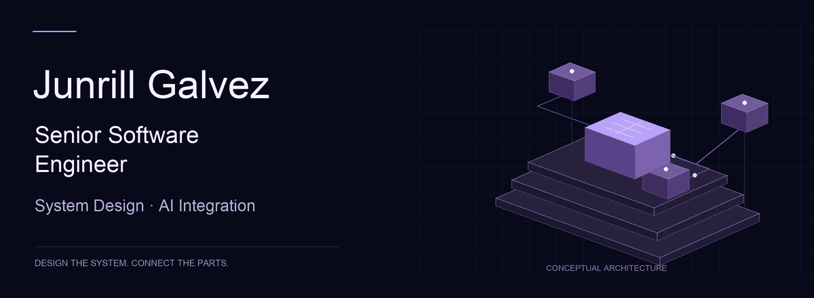

<a href="https://junrillg.pages.dev/">
  <picture>
    <source media="(prefers-reduced-motion: reduce)" srcset="assets/senior-engineer-still.png">
    
  </picture>
</a>

## Senior Software Engineer

**System Design & AI Integration**

I turn business requirements into clear system boundaries, connected platforms, and practical AI workflows. I bring **12+ years of hands-on engineering** and **9+ years leading teams**, from client discovery through production delivery.

**[Explore my portfolio →](https://junrillg.pages.dev/)** · [Get in touch](mailto:code.junrill@gmail.com)

### How I help

| Focus | What I bring |
| --- | --- |
| System design | Domain modeling, service boundaries, APIs, data platforms, and independently testable components. |
| Technical delivery | Translate business needs into technical decisions, connect product workflows, and guide teams from scoping to delivery. |
| AI integration | LLM integration, structured data extraction, workflow automation, and managed cloud AI with AWS Bedrock. |
| Cloud & delivery | AWS, Kubernetes, Terraform, containerized deployments, and CI/CD. |

### Selected engineering outcomes

- **~75% lower AI running costs** after migrating LLM workloads from self-hosted models to managed cloud AI.
- **Two-hour deployments reduced to five minutes** through parallel CI/CD jobs and containerized releases.
- **Backend and platform architecture for a product serving 25,000+ users by 2020**, connecting property, cashflow, and budgeting workflows.
- **Clearer service boundaries in a legacy platform** using layered architecture, Domain-Driven Design, and CQRS, alongside code review standards and mentoring.

[Read the work behind these outcomes →](https://junrillg.pages.dev/#work)

### Tools I work with

**Engineering:** C# / .NET · TypeScript · React / Next.js · Python / Django / Flask · Node.js / GraphQL

**Cloud & AI:** AWS EKS / RDS / Bedrock · Kubernetes · Terraform · LLM integration

**Data & design:** PostgreSQL · SQL Server · MySQL · Redis · DDD · CQRS · Clean Architecture

---

[Portfolio](https://junrillg.pages.dev/) · [GitHub Pages entry point](https://junrillg.github.io/) · [code.junrill@gmail.com](mailto:code.junrill@gmail.com)
