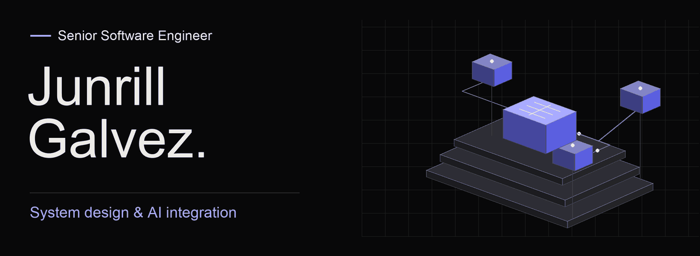

  <a href="https://junrillg.pages.dev/">
    <picture>
      <source media="(prefers-reduced-motion: reduce)" srcset="assets/architecture-notes-still.png">
      
    </picture>
  </a>

<h1 align="center">Junrill Galvez</h1>

<strong>Senior Software Engineer · System Design &amp; AI Integration</strong>

  <a href="https://junrillg.pages.dev/#work">Explore the architecture notes</a> ·
  <a href="https://junrillg.pages.dev/">Visit my portfolio</a> ·
  <a href="mailto:code.junrill@gmail.com">Get in touch</a>

I build hiring and financial software. I have 12+ years in full-stack engineering and 9+ years leading teams of up to 10. On a hiring platform, I moved AI processing to AWS Bedrock and cut AI running costs by about 75%. I also helped shorten deployments from two hours to five minutes by parallelizing pipeline jobs and automating release steps.

## Selected projects

| Project | What you can inspect |
| --- | --- |
| [Résumé matching](https://github.com/junrillg/resume-match-bedrock) | A reviewer chooses job requirements and sees which ones have supporting passages in a résumé. |
| [Candidate assessment](https://github.com/junrillg/candidate-assessment-lab) | How a candidate recovers an offline answer and how a reviewer publishes the final score. |
| [Approval workflow migration](https://github.com/junrillg/strangler-fig-razor-react) | A working approval app and my plan to replace one page while keeping records consistent. |

The portfolio walks through the decisions behind these projects. My CQRS field guide explains when it makes sense to separate reads from writes. [Interactive cases](https://junrillg.pages.dev/#work) · [CQRS field guide](https://github.com/junrillg/system-design-patterns/tree/main/docs/cqrs).

## Engineering background

I’ve restructured a legacy codebase around domain boundaries and separate command and query paths. Earlier, I helped shape the backend for a financial planning platform that served more than 25,000 users by 2020.

I work with C# and .NET, TypeScript and React, Python and Django, and infrastructure on AWS. PostgreSQL, Kubernetes, Terraform, and Bedrock are among the tools I use to take a design into production.
